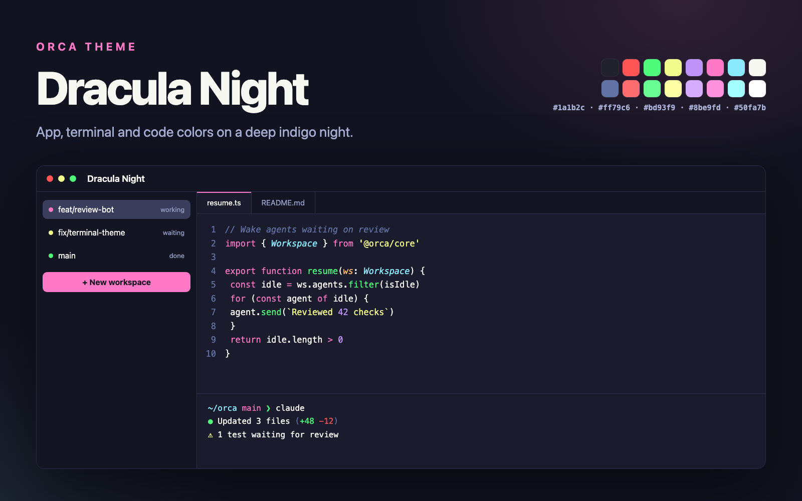

# Dracula Night for Orca

Dracula on a deep indigo night, in [Orca](https://www.onorca.dev): one dark theme for the app,
the terminal and the code editor, with Dracula's pink accents and bright syntax colors.

## Install

In Orca, open **Settings → Plugins**, search for **Dracula Night** and choose **Install**. Then:

- **Settings → Appearance → Theme**: choose Dracula Night as the dark theme.
- **Settings → Appearance → Terminal**: choose Dracula Night.

Requires Orca 1.4.246 or later.

## Colors

Dracula's own colors and roles, on a darker night background:

| Role | Color |
| --- | --- |
| Background | `#1a1b2c` |
| Sidebar, tabs | `#141522` |
| Accent, keywords, tags | `#ff79c6` |
| Focus, constants, numbers | `#bd93f9` |
| Types, classes (italic) | `#8be9fd` |
| Functions, attributes | `#50fa7b` |
| Strings | `#f1fa8c` |
| Parameters (italic) | `#ffb86c` |
| Comments (italic) | `#6272a4` |

The terminal uses Dracula's 16 ANSI colors.

## Credits

Syntax and terminal colors from [Dracula](https://draculatheme.com) (MIT). Dracula Night is not
affiliated with the Dracula project.

## Develop

`themes/` and `terminal/` are generated: edit the palette or roles in `scripts/build.mjs`, then run
`node scripts/build.mjs`. The build fails if Orca would drop any color for low contrast.

## License

MIT
